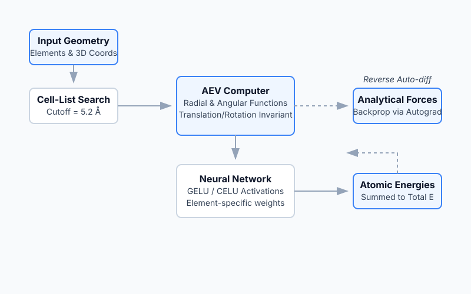

# Machine Learning Potentials (ANI)

The ANI (ANAKIN-ME) family of machine learning potentials seeks to deliver quantum-mechanical accuracy at speeds comparable to classical force fields. `sci-form` ships with a purely-Rust implementation of the ANI inference engine.

## Architecture

At its core, ANI maps local chemical environments to atomic energy contributions using a fully connected neural network (NN).



### 1. Spatial Partitioning & Neighbor Lists
To evaluate interactions efficiently in large systems, `sci-form` implements a cell-list algorithm for spatial partitioning (`src/ani/neighbor.rs`), bound by a configuration cutoff (5.2 Å for the default ANI-2x-style parameters). Atoms are binned into a 3D grid of cells with side length equal to the cutoff and only the 13 forward half-neighbour cells are scanned, which gives O(N) scaling for uniformly distributed systems.

### 2. Atomic Environment Vectors (AEVs)
The cartesian geometry is transformed into translationally and rotationally invariant features called AEVs, utilizing Behler-Parrinello symmetry functions (`src/ani/aev.rs`):
- **Radial Functions**: Probe the interatomic distances between the center atom and its neighbors.
- **Angular Functions**: Probe the angular relationships between the center atom and pairs of neighboring atoms.

### 3. Neural Network Engine
The AEVs are independently fed through element-specific forward-feed neural networks:
- Architectures leverage **CELU** (Continuously Differentiable Exponential Linear Units) and **GELU** activations for smooth gradients (`src/ani/nn.rs`, enum `Activation`).
- Evaluated entirely on CPU natively without heavy dependencies like PyTorch, accelerating single-shot inference.

### 4. Analytical Gradients (Forces)
The engine provides analytic derivations of atomic forces by back-propagating through both the neural network layers (`FeedForwardNet::backward`) and the underlying AEV coordinate transformations (`src/ani/gradients.rs`). The returned forces are the exact negative gradient of the total ANI energy and are checked against central finite differences in the unit tests `test_forces_match_finite_difference_energy` and `test_forces_match_finite_difference_methane` (`src/ani/gradients.rs`).

## AEV layout

There are **two different descriptor layouts** in the repository, and they are not interchangeable.

### `sci_form::ani` — species-split layout (`src/ani/aev.rs`)

With the default parameters from `ani::aev_params::default_ani2x_params()` the AEV of one atom has **4032** entries, laid out as:

| Block | Layout | Entries |
|-------|--------|---------|
| Radial | 7 species blocks (H, C, N, O, F, S, Cl), each `radial_eta.len() × radial_rs.len()` = 8 × 8 = 64 values, eta-major then shift-minor | 448 |
| Angular | 28 unordered species pairs (`lo ≤ hi`), each `angular_eta.len() × angular_rs.len() × angular_zeta.len() × angular_theta_s.len()` = 4 × 4 × 1 × 8 = 128 values | 3584 |

The pair index is the row-major enumeration of the upper triangle, `lo * N - lo * (lo + 1) / 2 + hi`, which is bijective over the 28 pairs (unit test `test_angular_pair_index_is_bijective`). Every `(eta, shift)` pair in the radial block contributes its own symmetry function — the radial block is **not** a zip of the two lists.

### `sci_form::ml::symmetry_functions` — species-agnostic layout (feature `alpha-mlff`)

The generalized descriptor module used by the MLFF path (`src/ml/symmetry_functions.rs`) is a different, species-agnostic layout:

| Block | Layout | Entries |
|-------|--------|---------|
| Radial | the **full (eta, shift) grid**: `radial_etas.len() × radial_shifts.len()` = 16 × 16 = 256 values, eta-major then shift-minor | 256 |
| Angular | `angular_shifts.len() × angular_etas.len() × angular_zetas.len()` = 4 × 4 × 4 = 64 values | 64 |

Total descriptor length: **320**. The element labels do not enter the descriptor at all. The radial block used to be filled with a zip of the shift and eta lists (only 16 of the 256 slots were ever computed); both the implementation and the F79 oracle now use the full grid.

## Weights

`src/ani/weights.rs` implements a **bespoke binary container**:

```text
u32  : number of element types
  per element:
    u8  : atomic number
    u32 : number of layers
      per layer:
        u32 : rows (output dim)
        u32 : cols  (input dim)
        f64 * (rows * cols) : weights, row-major
        f64 * rows          : bias
        u8                  : activation (0 = None, 1 = GELU, 2 = CELU)
```

Two consequences worth stating plainly:

- **The official ANI-2x `.netFormat` weight files cannot be loaded.** That container (the TorchANI/pickle format) has a different layout, and `sci-form` ships no converter for it. `ani::weights::load_weights` only reads the format above.
- The only weights available in-tree are `ani::weights::make_test_model(input_dim)`, which builds a small random two-layer network. It exists to exercise the code paths and is **not physically meaningful** — it must not be used to report ANI energies.

## Usage

### Rust API

```rust
use sci_form::ani::api::{compute_ani, AniConfig};
use sci_form::ani::weights::make_test_model;
use sci_form::ani::aev_params::default_ani2x_params;
use std::collections::HashMap;
use std::io::Cursor;

let elements = [8u8, 1, 1];
let positions = [
    [0.0, 0.0, 0.117],
    [0.0, 0.757, -0.469],
    [0.0, -0.757, -0.469],
];

// The network input dimension must match the real AEV length (4032 with the
// default parameters), otherwise the call fails with a dimension mismatch.
let aev_len = default_ani2x_params().total_aev_length();
let mut models: HashMap<u8, _> = HashMap::new();
for &z in &[1u8, 6, 7, 8] {
    models.insert(z, make_test_model(aev_len));
}

let config = AniConfig {
    compute_forces: true,
    ..Default::default()
};

let result = compute_ani(&elements, &positions, &config, &models)?;
println!("E = {} Ha", result.energy);
```

To read weights back from the bespoke container:

```rust
use sci_form::ani::weights::load_weights;

let mut file = std::fs::File::open("model.bin")?;
let models = load_weights(&mut file)?;
```

`ani::api::compute_ani_batch` runs the same computation over a slice of molecules. It is backed by rayon when the `parallel` feature is on and falls back to a sequential loop otherwise.

### Python API

```python
import sci_form

elements = [8, 1, 1]
coords = [0.0, 0.0, 0.117, 0.0, 0.757, -0.469, 0.0, -0.757, -0.469]

plan = sci_form.system_method_plan(elements)
print(plan.force_field_energy.methods)  # ANI details

res = sci_form.compare_methods(
    smiles="O",
    elements=elements,
    coords=coords
)
```

## Benchmarks & Validation

> **Corrección 2026-10-14**: un párrafo anterior afirmaba equivalencia con
> TorchANI al 0.0000 % — esa comparación nunca existió (nuestros AEV son
> agnósticos por especie en la ruta `ml::symmetry_functions`; TorchANI parte por
> especie). Estado real (gate F79, `tests/alpha_mlff_validation.rs`,
> `--features alpha-mlff`): AEV exactos contra una implementación numpy
> independiente de las fórmulas Behler-Parrinello (8 moléculas × 2 juegos de
> parámetros, constantes ANI-2x verificadas), energías de redes diminutas y
> fuerzas contra diferencias finitas centrales de la misma ruta. Las
> tolerancias están fijadas en el fixture
> `tests/fixtures/validation/mlff_bp.json` (AEV 1e-9, energía 1e-9, energía
> GELU 2e-6, fuerza 1e-4) y el oráculo es
> `scripts/validation/oracle_mlff.py`.
>
> Gaps pendientes: comparación de tensores contra TorchANI (diseño distinto) y
> benchmarks MD17/SPICE (requieren pesos entrenados, ver la sección
> *Weights*).

> **Corrección 2026-10-21**: el gate F79 existe y corre, pero solo cubre la
> ruta `ml::symmetry_functions`. El motor `ani::` (4032 features, redes por
> especie) **no** tiene gate externo: su exactitud se apoya en los tests
> unitarios de `src/ani/gradients.rs` (fuerza analítica contra diferencias
> finitas centrales) y en `src/ani/aev.rs`. Sin pesos ANI-2x oficiales
> cargables, tampoco existe una comparación de energías contra la literatura.
