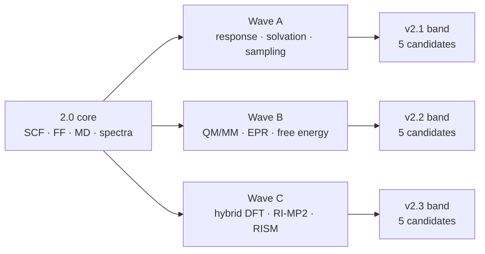

# v2.x feature roadmap: development towards v3

> **Status: proposal for evaluation, not a committed release plan.** This page
> records the candidate features considered for the `sci-form` 2.x line, the state of
> the art behind each one, the reuse path through the existing 2.0 code, and
> the gate that must pass before development starts. Nothing here is a promise
> of a release date or a stable API.
>
> Last updated: 2026-11-10. Baseline: `sci-form 2.0.0`.

## 1. Purpose

`sci-form` 2.0 is a fast calculation library: it parses molecules, generates
conformers, evaluates force fields and several electronic-structure methods,
and produces spectra, descriptors and materials. The v2.x question is different:

> Which **new predictive capabilities** turn those calculations into workflows
> that answer a scientific question end to end, without breaking the pure-Rust,
> WASM-friendly, validation-first design?

The portfolio below contains **15 fully scoped candidates**. Each one is new to
the library, has an independent oracle, and either reuses an existing module or
adds a thin layer on top of one. A separate [reserve list](#14-reserve-list)
records ideas that were deliberately deferred.

### 1.1 Versioning policy

The current release is `2.0.0`. Every candidate on this page is additive: a new
module, a new function or a new result type. None of them requires a breaking
change to a stable 2.0 path. They therefore land in minor releases, not in a
major release:

| Band | Target release | Scope |
|---|---|---|
| A | `v2.1` | response, solvation and sampling candidates |
| B | `v2.2` | environment, EPR, free-energy and ML candidates |
| C | `v2.3` | correlated, core-level and all-nuclide NMR candidates |

`v3.0` is **not** a feature bucket. It is the next major release only when a
documented breaking change — a removal, an incompatible signature or a semantic
change — is justified. Until then the development line stops at `v2.3`; v3 can
adopt the promoted features without renumbering them. This keeps the version
number tied to compatibility, not to the size of the roadmap.

## 2. Selection rules

A candidate enters a dossier only if it passes all five rules.

| Rule | Test |
|---|---|
| **New capability** | It is not a rename, a parameter set or a small optimisation of an existing method |
| **Scientific oracle** | There is a published reference implementation, an analytic limit or a public benchmark that can produce pass/fail evidence |
| **Reuse path** | At least one existing module supplies the orbitals, forces, geometries, spectra or data model it needs |
| **Surface fit** | A Rust API is possible; Python, WASM and CLI can expose a useful subset without a redesign |
| **Maintainable** | The method can be feature-gated during research and promoted with a documented confidence region |

A candidate is rejected when it needs a C++/Fortran runtime in the core, a
proprietary data file that cannot be redistributed, or a benchmark that the
project cannot run reproducibly.

### 2.1 Scoring

`Score = Impact + Fit + (6 − Effort) + (6 − Risk)`, each on a 1–5 scale.
Effort and risk are inverted because lower is better. The maximum is 20.

| Term | 1 | 5 |
|---|---|---|
| **Impact** | Niche analysis | Changes what users can build |
| **Fit** | New subsystem, little reuse | Mostly reuses existing modules |
| **Effort** | Days | Multiple months |
| **Risk** | Analytic oracle, clear theory | Ambiguous accuracy, heavy new dependency |

Scores are a planning aid, not a substitute for a spike. A high score with no
oracle is still a no-go.

## 3. Baseline: what 2.0 already covers

The portfolio avoids features that already exist. The current surface includes:

| Domain | Existing capabilities | Relevant modules |
|---|---|---|
| Geometry | SMILES, ETKDGv2, conformers, alignment, RMSD, clustering | `parse`, `embed`, `molecular_alignment`, `sdr` |
| Force fields | UFF, complete MMFF94, ReaxFF, ANI-2x/ANI-TM | `forcefield`, `ani` |
| Electronic structure | EHT, PM3, GFN0/1/2-xTB, HF-3c, CISD, SVWN/PBE KS-DFT | `eht`, `pm3`, `xtb`, `hf`, `scf`, `dft` |
| Spectroscopy | UV-Vis sTDA, IR + thermochemistry, HOSE/GIAO NMR, J-coupling | `spectroscopy`, `ir`, `nmr` |
| Solvation and charges | SASA, GB/HCT, ALPB, EEQ, CPM, EDL | `solvation`, `charges_eeq`, `cpm`, `edl` |
| Dynamics | NVT/NPT MD, Langevin, NEB, GSM, MBH, HTST, microkinetics | `dynamics`, `dynamics_live`, `gsm`, `kinetics` |
| Materials | Unit cells, 230 space groups, MOF assembly, PBC, powder XRD, KPM | `materials`, `periodic_linear`, `kpm` |
| ML | 17 descriptors, LogP/solubility/Lipinski, RF/GBM ensembles, ANI | `ml`, `ani` |
| Validation | 129 rows, 122 PASS, 7 method/provenance gaps, 0 FAIL | `reports/validation` |

**Do not re-propose:** the microkinetic ODE solver, empirical pKa, RRHO
thermochemistry, GIAO NMR, NPT/barostat, powder XRD or the D4 dispersion. They
already exist. A v2.x feature must add a capability, not rename one of these.

## 4. Portfolio at a glance



| ID | Candidate | Impact | Fit | Effort | Risk | Score | Target band |
|---|---|---:|---:|---:|---:|---:|---|
| V2-01 | Hybrid and range-separated DFT | 5 | 4 | 4 | 3 | **14** | v2.3 |
| V2-02 | RI-MP2 and local correlation | 4 | 4 | 4 | 3 | **13** | v2.3 |
| V2-03 | QM/MM with electrostatic embedding | 5 | 4 | 4 | 3 | **14** | v2.2 |
| V2-04 | EPR: g-tensor and hyperfine coupling | 4 | 4 | 3 | 3 | **14** | v2.2 |
| V2-05 | Raman, VCD and ROA spectroscopy | 4 | 5 | 3 | 2 | **16** | v2.1 |
| V2-06 | Core-level XPS and XANES | 3 | 3 | 4 | 3 | **11** | v2.3 |
| V2-07 | 3D-RISM solvation | 4 | 4 | 4 | 4 | **12** | v2.3 |
| V2-08 | First-principles redox and pKa | 5 | 5 | 3 | 3 | **16** | v2.1 |
| V2-09 | Alchemical free energies: FEP, BAR, MBAR | 5 | 4 | 4 | 3 | **14** | v2.2 |
| V2-10 | Enhanced sampling: WTMetaD, OPES, replica exchange | 5 | 5 | 3 | 2 | **17** | v2.1 |
| V2-11 | GCMC adsorption in porous materials | 4 | 5 | 3 | 2 | **16** | v2.1 |
| V2-12 | Reaction-network discovery and kMC | 5 | 5 | 3 | 3 | **16** | v2.1 |
| V2-13 | Universal equivariant MLIP backend | 5 | 4 | 4 | 3 | **14** | v2.2 |
| V2-14 | Uncertainty-aware active learning | 4 | 4 | 3 | 2 | **15** | v2.2 |
| V2-15 | Complete NMR coverage for all active nuclides | 5 | 4 | 5 | 4 | **12** | v2.3 |

The effort is order-of-magnitude for one experienced developer: Wave A is
roughly 27–41 person-weeks, Wave B 32–50, Wave C 46–70. The total portfolio is
therefore about **105–161 person-weeks**; it cannot ship as one release.

## 5. Evaluation waves

### 5.1 Development status

The Wave A branch is `feat/wave-a`. A prototype is not a promotion: the
validation set, bindings and the full documentation package still have to land
before a feature moves out of the prototype column.

| ID | Feature | Status in `feat/wave-a` | Remaining before promotion |
|---|---|---|---|
| V2-05 | Raman/VCD/ROA | Raman + VCD/ROA screening models | Coupled magnetic response and benchmark |
| V2-08 | Redox and pKa | Relative pKa and redox cycles implemented | Experimental benchmark, thermal corrections, bindings |
| V2-10 | Enhanced sampling | WTMetaD + replica exchange implemented | OPES, reweighting, multi-CV |
| V2-11 | GCMC adsorption | Lennard-Jones GCMC implemented | Charges/Ewald, multi-site guests, automatic typing |
| V2-12 | Reaction networks/kMC | Gillespie kMC implemented | Rule-based discovery, site-based surface kMC |


### Wave A — response, solvation, sampling (v2.1 band)

These candidates have the best score and the smallest conceptual distance from
the 2.0 code. Each can start with a numerical prototype and reuse a validated
engine.

| ID | First spike | Existing anchor |
|---|---|---|
| V2-05 | Numerical polarizability derivatives on top of the existing Hessian | `compute_vibrational_analysis`, `compute_ir_spectrum` |
| V2-08 | ALPB + xTB thermodynamic cycle for 10 acids and 10 bases | `compute_alpb_solvation`, `xtb`, `compute_empirical_pka` |
| V2-10 | WTMetaD on a two-dimensional analytic surface | `compute_md_trajectory_nvt`, `compute_simplified_neb_path` |
| V2-11 | GCMC insertion/deletion on a rigid MOF | `assemble_framework`, `forcefield`, `periodic_linear` |
| V2-12 | Recover a known five-step network from SMIRKS + GSM | `smirks`, `gsm`, `kinetics` |

### Wave B — environment, response, free energy (v2.2 band)

These add a new physical environment or a new statistical-mechanics layer.

| ID | First spike | Existing anchor |
|---|---|---|
| V2-03 | Point-charge QM/MM energy on water dimer | `eht`/`pm3`/`xtb`, `forcefield` |
| V2-04 | Isotropic hyperfine coupling for OH and CH3 | `compute_uhf`, `dft`, spin density |
| V2-09 | Harmonic-oscillator FEP and MBAR recovery | `dynamics`, `forcefield` |
| V2-13 | ONNX inference for one MACE-OFF model | `ani`, `alpha-mlff`, `dynamics` |
| V2-14 | Conformal calibration of an existing RF/GBM ensemble | `ml`, `ani`, validation rows |
| V2-15 | Multi-nucleus GIAO and isotope registry | `nmr`, `giao_nmr`, conformers |

### Wave C — correlated and core-level methods (v2.3 band)

These are the largest scientific lifts and should follow the wave A/B
infrastructure, not precede it.

| ID | First spike | Existing anchor |
|---|---|---|
| V2-01 | Exact-exchange KS-DFT for water and benzene | `scf`, `dft`, `hf` |
| V2-02 | RI-MP2 for water with a def2-SVP basis | `scf`, `CholeskyEris`, basis library |
| V2-06 | ΔSCF C 1s binding energy for CO and CH4 | `dft`, `ecp`, `stda` |
| V2-07 | 3D-RISM hydration free energy for ethanol | `solvation`, `charges_eeq`, `fft` |
| V2-15 | GIAO shift for ¹H, ¹³C, ¹⁵N and ³¹P in one run | `nmr`, `giao_nmr`, `scf` |

## 6. Feature dossiers

Each dossier is a development brief. It states what is new, why the method is
credible, how it plugs into 2.0, and what evidence would promote it.

### V2-01 · Hybrid and range-separated DFT

| Field | Value |
|---|---|
| Track | Electronic structure |
| Status | Candidate — evaluation required |
| Target | v2.3 |
| Effort | 10–16 person-weeks |
| Reuse | `scf` ERIs, `dft` grid and functionals, `hf` exchange, `CholeskyEris` |
| Surfaces | Rust, Python, CLI; WASM for small molecules |
| Gate | `alpha-dft-hybrid` until the PySCF parity gate passes |

**Gap.** The current KS-DFT engine supports SVWN and PBE only. Both are local
or semilocal functionals. They cannot describe exact exchange, and they inherit
the usual errors in reaction barriers, charge-transfer excitations and
open-shell systems. Every modern molecular DFT workflow expects at least one
hybrid functional.

**State of the art.** B3LYP and PBE0 remain the default hybrids in most
chemistry codes; range-separated hybrids such as ωB97X-V and the r2SCAN-3c
composite are the current accuracy references for main-group thermochemistry
and non-covalent interactions.

**Proposed method.** Add exact exchange from the existing four-index ERIs:

$$
E_x^{\mathrm{HF}} = -\frac{1}{2}\sum_{ij}^{\mathrm{occ}} (ij|ji)
$$

and assemble a hybrid functional as

$$
E_{xc} = a E_x^{\mathrm{HF}} + (1-a) E_x^{\mathrm{DFT}} + E_c^{\mathrm{DFT}}.
$$

For range separation, split the Coulomb operator:

$$
\frac{1}{r_{12}} =
\frac{1-\mathrm{erf}(\omega r_{12})}{r_{12}}
+
\frac{\mathrm{erf}(\omega r_{12})}{r_{12}}.
$$

The first term stays short-range exchange; the second is treated by the
long-range exact-exchange or semilocal component. Start with global hybrids
(PBE0, B3LYP), then add a range-separated functional once the `erf` integrals
are validated.

**Reuse map.** The SCF loop, DIIS, density matrix, grid, Becke partitioning and
nuclear gradient already exist. Exact exchange uses the same ERI tensor as HF;
the Cholesky path is the memory fallback for larger systems. Add a functional
enum and a basis/auxiliary-basis selector rather than a new SCF engine.

**API sketch.**

```rust
pub enum HybridFunctional { Pbe0, B3lyp, Wb97xV, R2scan3c }

pub struct HybridDftConfig {
    pub functional: HybridFunctional,
    pub basis: DftBasisKind,
    pub grid_quality: GridQuality,
    pub exact_exchange_fraction: Option<f64>,
}

pub fn compute_hybrid_dft_energy(
    elements: &[u8],
    positions_bohr: &[[f64; 3]],
    config: &HybridDftConfig,
) -> Result<DftResult, SciFormError>;

pub fn compute_hybrid_dft_gradient(
    elements: &[u8],
    positions_bohr: &[[f64; 3]],
    config: &HybridDftConfig,
) -> Result<Vec<[f64; 3]>, SciFormError>;
```

**Validation plan.**

| Oracle | Observable | Target |
|---|---|---|
| PySCF same functional/basis | Total energy | < 1e-5 Ha |
| Finite difference | Nuclear gradient | < 1e-4 Ha/Bohr |
| ORCA/PySCF 20-molecule set | Atomisation and reaction energies | < 3 kcal/mol spread vs same functional |
| SCF stress set | Convergence | < 100 iterations on 95 % of cases |

The gate is method parity, not experimental accuracy. A hybrid functional that
matches PySCF but disagrees with experiment is still a successful numerical
implementation; the method's own error belongs in the confidence region.

**Risks.** Exact exchange raises the SCF cost from `O(N^3)` to `O(N^4)` in the
naive path. Memory and wall time grow quickly beyond 30–40 atoms. The mitigation
is Cholesky or RI exact exchange, plus a native-only default and a smaller WASM
ceiling. Range separation adds `erf` integrals that do not exist yet.

**Acceptance / kill criteria.** Promote when the PySCF parity, gradient and SCF
stress gates pass and the 20-molecule set is documented. Stop if the RI/Cholesky
exchange path cannot keep water and benzene under the agreed memory budget.

**Documentation deliverables.** `algorithm/hybrid-dft.md` with the exchange
equations, basis and grid choices; API page with all four surfaces; validation
rows for PBE0, B3LYP and one range-separated functional; one animated diagram
showing exact-exchange vs semilocal exchange; at least three live examples.

---

### V2-02 · RI-MP2 and local correlation

| Field | Value |
|---|---|
| Track | Electronic structure |
| Status | Candidate — evaluation required |
| Target | v2.3 |
| Effort | 8–12 person-weeks |
| Reuse | `scf` orbitals, `CholeskyEris`, basis library, DIIS |
| Surfaces | Rust, Python, CLI; native-first |
| Gate | `alpha-mp2` until the PySCF parity gate passes |

**Gap.** HF-3c and CISD exist, but the library has no size-consistent
second-order correlation method. MP2 is the cheapest wavefunction correction
that captures dispersion and is the natural bridge between HF and the
correlated methods users expect.

**State of the art.** RI-MP2 made MP2 practical for medium molecules; SCS-MP2
and SOS-MP2 reduce its systematic errors, and local PNO/DLPNO-MP2 extends it to
larger systems. A v2.x implementation should ship RI-MP2 first, then SCS/SOS
variants, and leave local correlation as a follow-up.

**Proposed method.** Transform the ERIs to the molecular-orbital basis and
evaluate

$$
E_{\mathrm{MP2}} =
\sum_{ij}^{\mathrm{occ}}\sum_{ab}^{\mathrm{vir}}
\frac{|(ia|jb)|^2}
{\epsilon_i+\epsilon_j-\epsilon_a-\epsilon_b}.
$$

The RI approximation replaces the four-index integral by three-index factors:

$$
(ia|jb) \approx \sum_P B_{ia}^{P} B_{jb}^{P}.
$$

SCS-MP2 scales same-spin and opposite-spin contributions by 6/5 and 1/3;
SOS-MP2 uses a single 1.3 factor and avoids the opposite-spin tensor.

**Reuse map.** SCF supplies orbitals and orbital energies. `CholeskyEris`
supplies a compressed four-index representation when the full tensor does not
fit. The basis infrastructure already supports split-valence sets; add def2-SVP
and def2-TZVP plus the corresponding auxiliary basis. No new SCF is needed.

**API sketch.**

```rust
pub enum Mp2Variant { RiMp2, ScsMp2, SosMp2 }

pub struct Mp2Config {
    pub variant: Mp2Variant,
    pub basis: CorrelationBasis,
    pub frozen_core: bool,
    pub auxiliary_basis: Option<String>,
}

pub fn compute_mp2_energy(
    elements: &[u8],
    positions_bohr: &[[f64; 3]],
    config: &Mp2Config,
) -> Result<Mp2Result, SciFormError>;
```

**Validation plan.**

| Oracle | Observable | Target |
|---|---|---|
| PySCF RI-MP2 | Correlation energy | < 1e-6 Ha |
| Conventional MP2 | Correlation energy | < 1e-6 Ha |
| Basis convergence | Water and benzene | documented in the confidence region |
| Memory benchmark | 30–50 atoms | O(N^3) storage, no full N^4 tensor |

**Risks.** The four-index transform dominates memory and time. Frozen-core
handling, linear dependence in auxiliary bases and open-shell references add
edge cases. A local PNO implementation would be a separate project; do not
promise it in v2.1.

**Acceptance / kill criteria.** Promote when RI-MP2 and at least one SCS/SOS
variant reproduce PySCF on a 10-molecule set and the memory benchmark fits the
native budget. Stop if the auxiliary-basis fitting error cannot be separated
from the method error.

**Documentation deliverables.** `algorithm/ri-mp2.md`, equations for the RI
factorisation and SCS/SOS scaling, basis and frozen-core rules, a validation row
per variant, and a diagram of the AO→MO→RI pipeline.

---

### V2-03 · QM/MM with electrostatic embedding

| Field | Value |
|---|---|
| Track | Multiscale simulation |
| Status | Candidate — evaluation required |
| Target | v2.2 |
| Effort | 8–12 person-weeks |
| Reuse | `eht`, `pm3`, `xtb`, `hf`, `forcefield`, `materials` PBC |
| Surfaces | Rust, Python, CLI; native-first |
| Gate | `alpha-qmmm` until the point-charge and gradient gates pass |

**Gap.** The library can run a QM calculation on a small molecule or a force
field on a large system, but it cannot combine them. Enzymes, solvated reaction
centres, surfaces and doped materials all need a quantum region embedded in a
classical environment.

**State of the art.** Electrostatic embedding with link atoms is the standard
production QM/MM model; polarizable embedding and ML/MM are active research
extensions. The v2.x target is the well-understood electrostatic model, not a
polarizable one.

**Proposed method.** Partition the system into QM atoms `A` and MM point charges
`m`. The QM Hamiltonian gains the external potential

$$
H_{\mathrm{QM/MM}} =
H_{\mathrm{QM}}
+
\sum_m \sum_i \frac{q_m}{|\mathbf{r}_i-\mathbf{R}_m|}
+
\sum_m \sum_A \frac{q_m Z_A}{|\mathbf{R}_A-\mathbf{R}_m|}.
$$

The MM energy is evaluated on the same coordinates; subtract the MM-MM and
QM-QM double counting and add the link-atom bond, angle and charge corrections.
For PBC, use the minimum-image or Ewald path already present in the materials
and electrostatics code.

**Reuse map.** Any existing QM engine can be the quantum region: EHT for
orbitals, PM3/xTB for semiempirical energies, HF-3c for a wavefunction. UFF and
MMFF94 supply the classical region. The optimisers and MD integrators operate on
the combined gradient. This is a thin wrapper, not a second electronic-structure
engine.

**API sketch.**

```rust
pub enum Embedding { Mechanical, Electrostatic }

pub struct QmMmSystem {
    pub qm_elements: Vec<u8>,
    pub qm_positions: Vec<[f64; 3]>,
    pub mm_elements: Vec<u8>,
    pub mm_positions: Vec<[f64; 3]>,
    pub mm_charges: Vec<f64>,
    pub embedding: Embedding,
    pub link_atoms: Vec<LinkAtom>,
}

pub fn compute_qmmm_energy(
    system: &QmMmSystem,
    qm_method: QmMethod,
    mm_force_field: ForceFieldKind,
) -> Result<QmMmResult, SciFormError>;
```

**Validation plan.**

| Oracle | Observable | Target |
|---|---|---|
| Analytic point-charge test | QM/MM energy | < 1e-8 Ha |
| Finite difference | Combined gradient | < 1e-4 Ha/Bohr |
| ORCA/ONIOM or hand-built point-charge reference | Water dimer and a small cluster | < 1 kcal/mol |
| 1,000 MM atoms | Wall time and memory | documented budget |

**Risks.** Link-atom placement, charge penetration, boundary cuts and PBC are
the classic failure modes. A bad link atom can produce a plausible but wrong
energy. The gate must include a boundary test, not only a bulk-energy test.

**Acceptance / kill criteria.** Promote when the analytic point-charge test,
finite-difference gradient and at least one enzyme-like boundary test pass.
Stop if the link-atom correction cannot be made consistent with the MM force
field.

**Documentation deliverables.** `algorithm/qmmm.md` with the embedding
Hamiltonian, link-atom rules and PBC treatment; API page for all four surfaces;
one validation row per QM engine; an animated diagram of the QM/MM partition.

---

### V2-04 · EPR: g-tensor and hyperfine coupling

| Field | Value |
|---|---|
| Track | Spectroscopy |
| Status | Candidate — evaluation required |
| Target | v2.2 |
| Effort | 6–10 person-weeks |
| Reuse | `compute_uhf`, UKS in `dft`, spin density, `giao_nmr` response code |
| Surfaces | Rust, Python, CLI; WASM for small radicals |
| Gate | `alpha-epr` until the ORCA parity gate passes |

**Gap.** The library has no open-shell magnetic resonance. Radical mechanisms,
transition-metal centres and spin traps cannot be characterised beyond a
spin-density plot. EPR is the natural next spectroscopy after NMR.

**State of the art.** DFT hyperfine coupling and g-tensors are routine in ORCA
and ADF; the hard parts are spin contamination, relativistic effects for heavy
elements and the gauge origin. Start with light-element isotropic hyperfine
coupling, then add the dipolar tensor and the g-shift.

**Proposed method.** From the UKS/UHF spin density `ρ_s`, the isotropic Fermi
contact term is proportional to the density at the nucleus:

$$
A_{\mathrm{iso}} \propto \rho_s(\mathbf{R}_A).
$$

The anisotropic part comes from the spin-dipole integral. The g-tensor is

$$
\mathbf{g} = g_e \mathbf{1} + \Delta \mathbf{g},
$$

where `Δg` contains the spin-orbit and gauge corrections. The existing GIAO
response machinery for NMR is the closest code path: both need a perturbed
one-particle density and an integral response.

**Reuse map.** `compute_uhf` and the unrestricted KS path already produce
spin-polarised densities. `compute_giao_nmr` supplies the response-matrix
pattern. ECPs already exist for heavier elements. The geometry and conformer
pipelines provide the structures; the ensemble machinery can Boltzmann-average
conformers.

**API sketch.**

```rust
pub struct EprConfig {
    pub nucleus: u8,
    pub include_anisotropy: bool,
    pub include_g_tensor: bool,
    pub relativistic: RelativisticMode,
}

pub fn compute_epr_hyperfine(
    elements: &[u8],
    positions_bohr: &[[f64; 3]],
    config: &EprConfig,
) -> Result<EprResult, SciFormError>;

pub fn compute_epr_g_tensor(
    elements: &[u8],
    positions_bohr: &[[f64; 3]],
    config: &EprConfig,
) -> Result<GTensorResult, SciFormError>;
```

**Validation plan.**

| Oracle | Observable | Target |
|---|---|---|
| ORCA | Isotropic hyperfine coupling | < 5 % or 5 MHz on light radicals |
| ORCA | g-shift | < 100 ppm on organic radicals |
| Analytic hydrogen atom | Fermi contact | < 1 % |
| Conformer ensemble | Boltzmann-averaged A_iso | documented spread |

**Risks.** Spin contamination in UKS, gauge dependence and relativistic
effects are the main error sources. A doublet with a small gap can converge to
the wrong electronic state. The gate must record the spin expectation value and
the SCF stability, not only the final number.

**Acceptance / kill criteria.** Promote when OH, CH3 and one nitrogen-centred
radical pass the hyperfine gate and the g-tensor is within the stated tolerance
for at least three light-element radicals. Stop if spin contamination cannot be
controlled.

**Documentation deliverables.** `algorithm/epr.md` with the hyperfine and
g-tensor equations, spin-density conventions and units (MHz, G, ppm); API page;
validation rows for at least three radicals; diagram of the spin-density →
hyperfine pipeline.

---

### V2-05 · Raman, VCD and ROA spectroscopy

| Field | Value |
|---|---|
| Track | Spectroscopy |
| Status | Raman and VCD/ROA screening prototypes implemented in `feat/wave-a`; coupled response pending |
| Implementation | [algorithm/raman.md](/algorithm/raman) |
| Target | v2.1 |
| Effort | 4–6 person-weeks for the numerical path; 6–10 for analytic |
| Reuse | `compute_vibrational_analysis`, `compute_ir_spectrum`, SCF/ERI, GIAO response |
| Surfaces | Rust, Python, WASM, CLI |
| Gate | `alpha-raman` until the intensity and sign gates pass |

**Gap.** IR is implemented, but Raman and chiral vibrational spectroscopies are
not. Raman needs polarizability derivatives; VCD needs magnetic-dipole
derivatives; ROA needs the same response tensors with circular polarisation.
These are the standard companions to IR for structure assignment.

**State of the art.** Raman intensities from analytic polarizability
derivatives are routine; VCD and ROA are established for small and medium
molecules. The numerical finite-field route is slower but much easier to
validate and is the right first implementation.

**Proposed method.** For each normal mode `k`, compute the derivative of the
electric-dipole and polarizability tensors with respect to the normal
coordinate. The Raman activity is a rotational invariant of the polarizability
derivative:

$$
I_k \propto
\frac{(\nu_0-\nu_k)^4}{\nu_k}
\left(10\alpha_k'^2 + 7\beta_k'^2\right)
$$

where `α'` is the isotropic and `β'` the anisotropic derivative. VCD uses the
rotational strength

$$
R_k = \operatorname{Im}(\boldsymbol{\mu}_k \cdot \mathbf{m}_k),
$$

with the electric and magnetic transition dipoles. ROA uses the corresponding
circular-polarisation invariants.

The first implementation evaluates the polarizability by a central finite
field on the existing SCF, then differentiates along the mass-weighted normal
modes. The analytic CPHF path replaces the finite field once the numerical
results are trusted.

**Reuse map.** The numerical Hessian already produces normal modes and
frequencies. The IR code already computes dipole derivatives and broadening.
The GIAO response code provides the perturbed-density pattern. The spectrum
renderer and broadening functions are shared. No new geometry or force-field
code is needed.

**API sketch.**

```rust
pub enum VibrationalSpectrum { Ir, Raman, Vcd, Roa }

pub struct RamanConfig {
    pub field_step_au: f64,
    pub include_vcd: bool,
    pub include_roa: bool,
    pub broadening: Broadening,
}

pub fn compute_raman_spectrum(
    elements: &[u8],
    positions_bohr: &[[f64; 3]],
    config: &RamanConfig,
) -> Result<RamanSpectrum, SciFormError>;
```

**Validation plan.**

| Oracle | Observable | Target |
|---|---|---|
| ORCA/Gaussian | Raman peak positions | < 10 cm^-1 |
| ORCA/Gaussian | Relative Raman intensities | < 20 % |
| ORCA/Gaussian | VCD sign for five chiral molecules | 5/5 correct signs |
| Finite difference | Polarizability derivative | < 1 % |

**Risks.** Numerical polarizability derivatives are sensitive to the field step
and SCF convergence. VCD sign is sensitive to the gauge and to the normal-mode
phase. The gate must compare signed spectra, not absolute intensities only.

**Acceptance / kill criteria.** Promote when the numerical Raman path matches
the reference positions and intensities on at least five molecules and VCD
signs are correct. Stop if the finite-field noise cannot be separated from the
physical signal.

**Documentation deliverables.** `algorithm/raman-vcd.md` with the invariants,
normal-mode derivatives and broadening; API page; validation rows for Raman and
VCD; animated diagram of the finite-field/CPHF path.

---

### V2-06 · Core-level XPS and XANES

| Field | Value |
|---|---|
| Track | Spectroscopy |
| Status | Candidate — evaluation required |
| Target | v2.3 |
| Effort | 8–12 person-weeks |
| Reuse | `dft`, `ecp`, `stda`, UV-Vis broadening, basis library |
| Surfaces | Rust, Python, CLI; native-first |
| Gate | `alpha-core-spectroscopy` until the reference-edge gate passes |

**Gap.** UV-Vis covers valence excitations only. Core-level XPS binding energies
and XANES edges are the standard probes for oxidation state, coordination and
electronic structure, and the library cannot produce them.

**State of the art.** ΔSCF is the workhorse for core binding energies;
restricted-excitation-window TDDFT and transition-potential approaches are the
standard for XANES. ML surrogates are emerging but need large reference sets;
they are not the first implementation.

**Proposed method.** For XPS, compute the energy difference between the ground
state and a core-hole state:

$$
E_b = E_{\mathrm{core-hole}} - E_{\mathrm{ground}}.
$$

For XANES, restrict the excitation space to the core orbitals and use the
existing sTDA/CIS machinery with a core hole or transition potential. Apply the
same Gaussian/Lorentzian broadening already used for UV-Vis.

**Reuse map.** The KS-DFT engine supplies ground and core-hole energies. ECPs
already handle core electrons for heavier elements. sTDA supplies the
excitation solver and broadening. The basis library needs core-polarisation
functions and a clear core-orbital selector.

**API sketch.**

```rust
pub struct CoreSpectroscopyConfig {
    pub edge: CoreEdge,          // K, L1, L2, L3
    pub element: u8,
    pub method: CoreMethod,      // DeltaScf, TransitionPotential, Stda
    pub broadening_ev: f64,
}

pub fn compute_xps_binding_energy(
    elements: &[u8],
    positions_bohr: &[[f64; 3]],
    config: &CoreSpectroscopyConfig,
) -> Result<XpsResult, SciFormError>;

pub fn compute_xanes_spectrum(
    elements: &[u8],
    positions_bohr: &[[f64; 3]],
    config: &CoreSpectroscopyConfig,
) -> Result<XanesResult, SciFormError>;
```

**Validation plan.**

| Oracle | Observable | Target |
|---|---|---|
| Experiment / reference ΔSCF | C, N, O 1s binding energies | MAE < 1.5 eV on 10 molecules |
| Reference XANES | Edge position | < 2 eV |
| Reference XANES | Spectral shape | Spearman correlation > 0.9 |
| Basis/core-hole scan | Convergence | documented threshold |

**Risks.** Core-hole states are high in energy and can converge to the wrong
state; basis-set and relativistic corrections matter; absolute binding energies
are functional-dependent. Report both absolute and relative (chemical-shift)
errors, and never hide the functional.

**Acceptance / kill criteria.** Promote when the 10-molecule XPS set and at
least two XANES edges pass the gate. Stop if the core-hole SCF cannot be made
stable with the existing DIIS.

**Documentation deliverables.** `algorithm/xps-xanes.md` with ΔSCF, transition
potential and core-excitation theory; API page; validation rows for C/N/O
edges; diagram of the core-hole pipeline.

---

### V2-07 · 3D-RISM solvation

| Field | Value |
|---|---|
| Track | Solvation and statistical mechanics |
| Status | Candidate — evaluation required |
| Target | v2.3 |
| Effort | 10–14 person-weeks |
| Reuse | `solvation` ALPB/GB, `charges_eeq`, `edl`, ESP grid, FFT |
| Surfaces | Rust, Python, CLI; native-first, WASM with a smaller grid |
| Gate | `alpha-rism` until the hydration-free-energy gate passes |

**Gap.** GB/HCT and ALPB are fast implicit models, but they do not produce a
three-dimensional solvent density, solvent structure near a surface, or a
solvation free energy from an explicit molecular solvent. 3D-RISM fills that
gap and connects directly to the existing electrostatic grids.

**State of the art.** 3D-RISM with the Kovalenko–Hirata closure is implemented
in Amber, MOE and open-source RISM codes. It is used for hydration free
energies, ion distribution, cosolvent mapping and X-ray scattering. 3D-DFT is
more accurate but substantially more expensive; 3D-RISM is the pragmatic first
target.

**Proposed method.** Solve the three-dimensional Ornstein–Zernike equation

$$
h_\gamma(\mathbf{r}) =
\sum_{\gamma'} \int
c_{\gamma'}(\mathbf{r}')\,
\chi_{\gamma\gamma'}(|\mathbf{r}-\mathbf{r}'|)\,
d\mathbf{r}'
+
c_\gamma(\mathbf{r})
$$

with the Kovalenko–Hirata closure, where `h` is the total correlation function,
`c` the direct correlation function and `χ` the solvent susceptibility. The
solute–solvent interaction uses the existing Coulomb and Lennard-Jones
potentials; the convolution is an FFT.

**Reuse map.** ALPB/GB provide a fast reference and the solvation API shape.
EEQ or Mulliken charges supply the solute charges. The ESP grid code supplies
the real-space grid and the FFT-friendly layout. EDL code supplies the
electrolyte/ionic-strength concepts. The output is a new `Solvation3D` result,
not a replacement for ALPB.

**API sketch.**

```rust
pub struct RismConfig {
    pub solvent: SolventModel,      // SPC/E, TIP3P, custom
    pub closure: RismClosure,       // KH, HNC
    pub grid: GridSpec,
    pub ionic_strength_m: f64,
    pub temperature_k: f64,
}

pub fn compute_rism_solvation(
    elements: &[u8],
    positions_bohr: &[[f64; 3]],
    config: &RismConfig,
) -> Result<RismResult, SciFormError>;
```

**Validation plan.**

| Oracle | Observable | Target |
|---|---|---|
| Reference 3D-RISM | Hydration free energy | MAE < 1 kcal/mol on 10 molecules |
| Reference 3D-RISM | Solvent density at contact | qualitative profile match |
| ALPB/GB | Solute–solvent electrostatics | documented correlation |
| Grid convergence | Free energy | < 0.1 kcal/mol |

**Risks.** The OZ solver is iterative and can fail for strong local charges;
FFT memory grows with the cube of the grid; solvent force-field parameters and
closure choice dominate the error. The gate must include convergence and
failure diagnostics, not only a final number.

**Acceptance / kill criteria.** Promote when the hydration free-energy set and
at least one density profile pass. Stop if the OZ iteration is not robust on
the test set.

**Documentation deliverables.** `algorithm/3d-rism.md` with the OZ equation,
closure, solvent susceptibility and FFT layout; API page; validation rows for
hydration free energy and density; diagram of the solute–solvent grid.

---

### V2-08 · First-principles redox and pKa

| Field | Value |
|---|---|
| Track | Electrochemistry and thermodynamics |
| Status | Prototype implemented in `feat/wave-a`; validation and bindings pending |
| Implementation | [algorithm/redox-pka.md](/algorithm/redox-pka) |
| Target | v2.1 |
| Effort | 4–6 person-weeks |
| Reuse | `alpb`, `xtb`, `dft`, `conformers`, `thermochemistry`, `empirical_pka` |
| Surfaces | Rust, Python, WASM, CLI |
| Gate | `alpha-redox-pka` until the benchmark set passes |

**Gap.** `compute_empirical_pka` is a graph/charge heuristic. CPM and EDL model
electrodes, but there is no molecular thermodynamic cycle that predicts a
solution pKa or a redox potential from electronic structure. This is a natural
extension of the existing solvation and thermochemistry stack.

**State of the art.** Thermodynamic cycles with implicit solvation are the
standard for pKa and redox potentials in quantum-chemistry workflows. Direct and
indirect cycles, proton-solvation corrections and conformer averaging are well
documented; the accuracy is typically 0.5–1.5 pKa units and 0.1–0.3 V for
well-behaved systems.

**Proposed method.** For deprotonation,

$$
\mathrm{HA} \rightarrow \mathrm{A^-} + \mathrm{H^+},
$$

compute

$$
\Delta G_{\mathrm{dep}} =
G(\mathrm{A^-}) + G(\mathrm{H^+}) - G(\mathrm{HA}),
\qquad
\mathrm{p}K_a = \frac{\Delta G_{\mathrm{dep}}}{RT\ln 10}.
$$

For a redox couple,

$$
E^\circ = -\frac{\Delta G^\circ}{nF}.
$$

Use the existing xTB or DFT energy, ALPB solvation, thermochemical corrections
and a Boltzmann average over conformers. The empirical pKa remains a fast
pre-screen, not the reference.

**Reuse map.** The conformer pipeline generates the states; xTB/DFT computes the
electronic energy; ALPB supplies the solvation free energy; thermochemistry
supplies the thermal correction; the ensemble code supplies Boltzmann weights.
No new electronic-structure engine is needed for the first release.

**API sketch.**

```rust
pub struct RedoxPkaConfig {
    pub method: EnergyMethod,       // Xtb, Pbe, Pbe0
    pub solvent: Solvent,
    pub temperature_k: f64,
    pub conformer_ensemble: bool,
}

pub fn compute_pka(
    smiles: &str,
    site: PkaSite,
    config: &RedoxPkaConfig,
) -> Result<PkaResult, SciFormError>;

pub fn compute_redox_potential(
    smiles: &str,
    couple: RedoxCouple,
    config: &RedoxPkaConfig,
) -> Result<RedoxResult, SciFormError>;
```

**Validation plan.**

| Oracle | Observable | Target |
|---|---|---|
| SAMPL pKa set | pKa | MAE < 1.0 unit on the internal subset |
| Experimental redox set | E° | MAE < 0.2 V |
| Empirical pKa | Rank correlation | report as a baseline, not a gate |
| Conformer ensemble | Sensitivity | documented spread |

**Risks.** Proton solvation and electron conventions are the classic sources of
silent errors. Absolute potentials depend on the reference electrode and the
standard-state convention. The documentation must state both explicitly, and
the API must carry units and reference states.

**Acceptance / kill criteria.** Promote when the pKa and redox sets pass and the
conventions are documented. Stop if the conformer spread is larger than the
claimed accuracy without a mitigation.

**Documentation deliverables.** `algorithm/redox-pka.md` with the cycles,
conventions, reference electrodes and standard states; API page; validation rows
for acids, bases and redox couples; diagram of the thermodynamic cycle.

---

### V2-09 · Alchemical free energies: FEP, BAR and MBAR

| Field | Value |
|---|---|
| Track | Free energy and statistical mechanics |
| Status | Candidate — evaluation required |
| Target | v2.2 |
| Effort | 8–12 person-weeks |
| Reuse | `dynamics`, `forcefield`, `mlff`, `alpb`, `parallel` |
| Surfaces | Rust, Python, CLI; native-first, WASM for toy systems |
| Gate | `alpha-free-energy` until the analytic and solvation gates pass |

**Gap.** The library can run MD and compute energies, but it cannot compute a
free-energy difference. Relative solvation, binding and mutation free energies
are the core quantities in drug discovery and materials screening.

**State of the art.** FEP, BAR and MBAR are mature; the modern practice is
soft-core potentials, Hamiltonian replica exchange and careful overlap
diagnostics. ML potentials are beginning to replace the energy engine, but the
estimator remains the same.

**Proposed method.** Define alchemical states `0` and `1` and a path
`λ ∈ [0,1]`. The Zwanzig estimator is

$$
\Delta A_{0\to1} =
-k_B T \ln \left\langle e^{-\beta \Delta U}\right\rangle_0.
$$

BAR uses both directions; MBAR solves the multistate likelihood over all
samples. Use a soft-core potential to avoid endpoint singularities, run
Hamiltonian replica exchange when overlap is poor, and report the overlap matrix
and the statistical inefficiency.

**Reuse map.** The MD integrators, thermostats, barostat and neighbour lists
already exist. UFF, MMFF94, ReaxFF and ANI can be the energy engine. ALPB/GB
supply implicit solvent; the parallel feature supplies independent λ windows.
This is a new estimator and workflow layer, not a new force field.

**API sketch.**

```rust
pub struct FreeEnergyPlan {
    pub lambdas: Vec<f64>,
    pub softcore: SoftCore,
    pub samples_per_window: usize,
    pub estimator: FreeEnergyEstimator, // Bar, Mbar
    pub exchange: bool,
}

pub fn compute_alchemical_free_energy(
    system: &AlchemicalSystem,
    plan: &FreeEnergyPlan,
    engine: EnergyEngine,
) -> Result<FreeEnergyResult, SciFormError>;
```

**Validation plan.**

| Oracle | Observable | Target |
|---|---|---|
| Harmonic oscillator | ΔA | < 0.01 kcal/mol |
| Analytic ideal gas | ΔA | < 0.05 kcal/mol |
| Reference hydration free energies | ΔG_hyd | < 0.5 kcal/mol |
| MBAR vs BAR | Consistency | within statistical error |
| Overlap matrix | Diagnostic | no disconnected windows |

**Risks.** Poor overlap, endpoint singularities, insufficient sampling and
force-field mismatch can all produce a precise but wrong number. The API must
return uncertainty and diagnostics by default, not as an optional extra.

**Acceptance / kill criteria.** Promote when the analytic and hydration gates
pass and the overlap diagnostic catches a deliberately bad λ schedule. Stop if
the estimator cannot distinguish a bad schedule from a good one.

**Documentation deliverables.** `algorithm/free-energy.md` with FEP/BAR/MBAR,
soft-core, λ schedules and uncertainty; API page; validation rows for analytic
and solvation cases; diagram of the λ windows and estimator.

---

### V2-10 · Enhanced sampling: WTMetaD, OPES and replica exchange

| Field | Value |
|---|---|
| Track | Dynamics and free energy |
| Status | WTMetaD and replica exchange prototypes implemented in `feat/wave-a`; OPES/reweighting pending |
| Implementation | [algorithm/enhanced-sampling.md](/algorithm/enhanced-sampling) |
| Target | v2.1 |
| Effort | 5–8 person-weeks |
| Reuse | `compute_md_trajectory_nvt`, NEB/GSM path CV, RMSD, force fields |
| Surfaces | Rust, Python, CLI; WASM for small systems |
| Gate | `alpha-enhanced-sampling` until the analytic free-energy gate passes |

**Gap.** The MD module integrates Newton's equations and the conformer search
samples minima, but there is no way to compute a free-energy surface along a
collective variable. Metadynamics and replica exchange are the standard tools
for that question.

**State of the art.** Well-tempered metadynamics and OPES are the current
flavours; Hamiltonian replica exchange is the standard fallback when a good
collective variable is hard to define. The first implementation should support
distance, angle, coordination number, RMSD and path collective variables.

**Proposed method.** Add a bias

$$
V_b(\mathbf{s},t) =
\sum_{k} h_k \exp\left(
-\frac{(\mathbf{s}-\mathbf{s}_k)^2}{2\sigma^2}
\right)
$$

with the well-tempered height

$$
h_k = h_0 \exp\left(-\frac{V_b(\mathbf{s}_k,t)}{\Delta T}\right).
$$

OPES replaces the Gaussian sum with a kernel density estimate in the
probability space. Replica exchange swaps configurations between Hamiltonians
or temperatures with a Metropolis criterion. Reweight the biased trajectory to
recover the unbiased free energy.

**Reuse map.** The existing NVT/NPT integrators, thermostats and barostat supply
the dynamics. NEB/GSM supply path coordinates for a path CV; RMSD supplies a
structural CV. The force fields and MLIP supply the potential. The analysis
layer can reuse the histogram and broadening utilities.

**API sketch.**

```rust
pub enum CollectiveVariable {
    Distance { i: usize, j: usize },
    Angle { i: usize, j: usize, k: usize },
    Coordination { i: usize, j: usize, cutoff: f64 },
    Rmsd { reference: Vec<[f64; 3]> },
    Path { images: Vec<Vec<[f64; 3]>>, lambda: f64 },
}

pub struct MetaDynamicsConfig {
    pub cv: CollectiveVariable,
    pub height_kcal: f64,
    pub sigma: f64,
    pub bias_factor: f64,
    pub pace_steps: usize,
    pub temperature_k: f64,
}

pub fn run_metadynamics(
    system: &mut DynamicSystem,
    config: &MetaDynamicsConfig,
) -> Result<FreeEnergySurface, SciFormError>;
```

**Validation plan.**

| Oracle | Observable | Target |
|---|---|---|
| Analytic double well | Free-energy barrier | < 1 kcal/mol |
| Long unbiased MD | Reweighted PMF | within statistical error |
| Alanine dipeptide or a small analogue | φ/ψ landscape | qualitative match to reference |
| Replica exchange | Acceptance rate | 20–40 % in the tested regime |

**Risks.** A bad CV hides the slow mode; Gaussian deposition can be too
aggressive; reweighting can be unstable. The API must expose the CV, the bias
history and the reweighting diagnostics.

**Acceptance / kill criteria.** Promote when the analytic barrier and the
unbiased-MD comparison pass, and the implementation recovers a known
two-dimensional landscape. Stop if the reweighting cannot reproduce the
unbiased result on the analytic surface.

**Documentation deliverables.** `algorithm/enhanced-sampling.md` with WTMetaD,
OPES, replica exchange and reweighting; API page; validation rows for the
analytic surface and a molecular example; diagram of the bias and CV.

---

### V2-11 · GCMC adsorption in porous materials

| Field | Value |
|---|---|
| Track | Materials and statistical mechanics |
| Status | Lennard-Jones GCMC prototype implemented in `feat/wave-a`; charges/Ewald and multi-site guests pending |
| Implementation | [algorithm/gcmc.md](/algorithm/gcmc) |
| Target | v2.1 |
| Effort | 6–9 person-weeks |
| Reuse | `assemble_framework`, `forcefield`, `periodic_linear`, `charges_eeq`, `d4` |
| Surfaces | Rust, Python, CLI; native-first |
| Gate | `alpha-gcmc` until the RASPA/experiment gate passes |

**Gap.** The materials module builds MOFs, computes cells and simulates XRD,
but it cannot answer the central materials question: how much gas does the
framework adsorb at a given pressure and temperature?

**State of the art.** Grand-canonical Monte Carlo with insertion/deletion,
Ewald electrostatics and tail corrections is the standard; RASPA and MUSIC are
the reference implementations. ML potentials are beginning to replace the
classical energy engine, but the GCMC estimator is unchanged.

**Proposed method.** In the grand canonical ensemble, insert a particle with
probability

$$
P_{\mathrm{ins}} =
\min\left[
1,\,
\frac{V}{\Lambda^3(N+1)}
\exp\left(-\beta \Delta U\right)
\right],
$$

and delete with the reverse acceptance rule. Sample the fugacity from the
target pressure and temperature, use Ewald or a neutralising background for
charged frameworks, and apply tail corrections for the truncated
Lennard-Jones potential.

**Reuse map.** `assemble_framework` supplies the periodic structure.
UFF/MMFF94 and D4 supply the guest–framework and guest–guest interactions.
`periodic_linear` supplies the k-space/Ewald mindset; `charges_eeq` supplies
framework charges. The output is an isotherm plus density profiles.

**API sketch.**

```rust
pub struct GcmcConfig {
    pub temperature_k: f64,
    pub pressures_bar: Vec<f64>,
    pub guest: GuestModel,
    pub framework_charges: ChargeModel,
    pub electrostatics: Electrostatics, // Cutoff, Ewald
    pub moves: GcmcMoves,
}

pub fn compute_gcmc_isotherm(
    framework: &Framework,
    config: &GcmcConfig,
) -> Result<AdsorptionIsotherm, SciFormError>;
```

**Validation plan.**

| Oracle | Observable | Target |
|---|---|---|
| RASPA | CO2 uptake in MOF-5 | < 10 % relative |
| RASPA | N2 uptake in HKUST-1 | < 10 % relative |
| Experiment | Isotherm shape | qualitative + stated confidence region |
| Block averaging | Statistical error | reported per point |

**Risks.** Framework flexibility, framework charges, Ewald convergence and
guest model parameters dominate the error. A rigid framework is the right first
scope; flexibility is a later extension.

**Acceptance / kill criteria.** Promote when two reference isotherms pass and
the statistical error is reported. Stop if the Ewald/charge model cannot
reproduce the reference within the stated tolerance.

**Documentation deliverables.** `algorithm/gcmc.md` with the acceptance rules,
fugacity, Ewald and tail corrections; API page; validation rows for CO2/N2
isotherms; animated diagram of insertion/deletion.

---

### V2-12 · Reaction-network discovery and kinetic Monte Carlo

| Field | Value |
|---|---|
| Track | Reactivity and kinetics |
| Status | Gillespie kMC prototype implemented in `feat/wave-a`; network discovery pending |
| Implementation | [algorithm/kmc.md](/algorithm/kmc) |
| Target | v2.1 |
| Effort | 8–12 person-weeks |
| Reuse | `smirks`, `gsm`, `mbh`, `kinetics`, microkinetic solver, fingerprints |
| Surfaces | Rust, Python, CLI; native-first |
| Gate | `alpha-reaction-network` until the known-network and kMC gates pass |

**Gap.** The microkinetic solver and HTST exist, but they require a reaction
network as input. The library cannot discover the network, rank the pathways or
run a stochastic surface reaction. That is the missing link between a SMILES
and a catalytic or combustion mechanism.

**State of the art.** Rule-based generators (RMG), automated ab initio
exploration (AARON, Chemoton) and growing-string/AFIR methods are the standard
for network discovery. Kinetic Monte Carlo is the standard for surface and
stochastic kinetics. The first version should be rule-based and deterministic,
with GSM/MBH refining the barriers.

**Proposed method.** Represent each species as a molecular graph. Apply SMIRKS
transformations to enumerate elementary steps, deduplicate by canonical graph
and fingerprint, and reject invalid valences. Refine each candidate barrier with
GSM or MBH and HTST. Assemble the network into the existing microkinetic
solver. For surface reactions, expose a kMC engine with adsorption, desorption,
diffusion and reaction events.

**Reuse map.** `smirks` applies the transformations; `gsm`/`mbh` refine saddles;
`kinetics` computes HTST rates and solves microkinetic networks; fingerprints
deduplicate species. The new code is the generator and the kMC event loop.

**API sketch.**

```rust
pub struct NetworkConfig {
    pub initial_species: Vec<String>,
    pub rules: Vec<String>,          // SMIRKS
    pub max_depth: usize,
    pub barrier_method: BarrierMethod,
    pub temperature_k: f64,
}

pub fn discover_reaction_network(
    config: &NetworkConfig,
) -> Result<ReactionNetwork, SciFormError>;

pub fn run_kinetic_monte_carlo(
    network: &ReactionNetwork,
    config: &KmcConfig,
) -> Result<KmcTrace, SciFormError>;
```

**Validation plan.**

| Oracle | Observable | Target |
|---|---|---|
| Published mechanism | Species and elementary steps | 5/5 known networks recovered |
| Reference barriers | Barrier MAE | < 2 kcal/mol |
| ODE microkinetics | kMC vs ODE | < 5 % on mean populations |
| Determinism | Same seed | identical trace |

**Risks.** Combinatorial explosion, invalid chemistry from broad SMIRKS rules,
and barrier errors that change the dominant pathway. The generator must have a
depth limit, valence checks and a deterministic canonicalisation.

**Acceptance / kill criteria.** Promote when at least five known networks are
recovered and kMC agrees with the ODE solver. Stop if the rule set produces more
invalid than valid species on the test set.

**Documentation deliverables.** `algorithm/reaction-networks.md` with graph
transforms, deduplication, barrier refinement and kMC; API page; validation rows
for known networks; diagram of the generate → refine → solve pipeline.

---

### V2-13 · Universal equivariant MLIP backend

| Field | Value |
|---|---|
| Track | Machine learning potentials |
| Status | Candidate — evaluation required |
| Target | v2.2 |
| Effort | 6–10 person-weeks |
| Reuse | `ani`, `alpha-mlff`, `dynamics`, neighbour lists, PBC |
| Surfaces | Rust, Python, CLI; WASM via a pure-Rust ONNX runtime |
| Gate | `alpha-mlip` until the MD17/SPICE subset gate passes |

**Gap.** ANI-2x and ANI-TM are fixed architectures with fixed element coverage.
The field has moved to universal, equivariant foundation potentials that cover
the periodic table and handle surfaces, molecules and reactions with one model.
The gated MLFF module is an internal architecture, not a model registry.

**State of the art.** MACE, CHGNet, Orb and eSEN are the current universal
families; MACE-OFF and MACE-MP-0 are common molecular/materials checkpoints.
The practical integration is an ONNX model with a stable metadata header, not a
hard-coded architecture.

**Proposed method.** Add a model registry and an inference engine that consumes
ONNX graphs through a pure-Rust runtime such as `tract`. The model receives
positions, elements, cell and periodic shifts; it returns energy, forces and
stress. The neighbour list and PBC wrapping come from the existing dynamics
code. Species, charge and spin metadata are declared in the model manifest.

**Reuse map.** The ANI module supplies the inference pattern and element
mapping. The MLFF gate supplies the feature-flag precedent. The MD integrators,
neighbour lists and barostat consume the forces directly. PBC supplies the cell
and shifts. No new trainer is required.

**API sketch.**

```rust
pub struct MlipManifest {
    pub name: String,
    pub elements: Vec<u8>,
    pub cutoff_angstrom: f64,
    pub supports_stress: bool,
    pub license: String,
}

pub fn load_mlip_model(
    onnx_path: &Path,
    manifest: &MlipManifest,
) -> Result<MlipModel, SciFormError>;

pub fn compute_mlip_energy(
    model: &MlipModel,
    elements: &[u8],
    positions: &[[f64; 3]],
    cell: Option<&Cell>,
) -> Result<MlipResult, SciFormError>;
```

**Validation plan.**

| Oracle | Observable | Target |
|---|---|---|
| MD17 subset | Energy MAE | < 1 meV/atom |
| MD17 subset | Force MAE | < 50 meV/Å |
| SPICE subset | Energy/force | documented per model |
| MACE reference | Same model, same structure | < 1e-4 eV |
| CPU throughput | Atoms × steps/s | documented budget |

**Risks.** Model licences vary; do not bundle weights without a licence review.
ONNX operator coverage, memory and WASM size are the main engineering risks.
Stress and PBC support vary by model and must be declared, not assumed.

**Acceptance / kill criteria.** Promote when one molecular and one materials
checkpoint pass the reference parity and throughput gates, and the licence
permits redistribution or user-supplied weights. Stop if the pure-Rust runtime
cannot execute the selected operators.

**Documentation deliverables.** `algorithm/universal-mlip.md` with the model
contract, ONNX manifest, PBC and stress conventions; API page; validation rows
per checkpoint; diagram of the model registry and MD coupling.

---

### V2-14 · Uncertainty-aware active learning

| Field | Value |
|---|---|
| Track | Machine learning |
| Status | Candidate — evaluation required |
| Target | v2.2 |
| Effort | 4–6 person-weeks |
| Reuse | `ml` RF/GBM ensembles, `ani`, `mlip`, descriptors, validation rows |
| Surfaces | Rust, Python, CLI; WASM for inference |
| Gate | `alpha-active-learning` until calibration and label-efficiency gates pass |

**Gap.** The existing ensemble returns an uncertainty for LogP, but the library
has no general uncertainty contract, no calibration check and no active-learning
loop. Users cannot tell when a prediction is outside its training domain.

**State of the art.** Ensemble variance, query-by-committee and conformal
prediction are the standard lightweight approaches; they are compatible with
the existing RF/GBM ensembles and with MLIPs. Conformal prediction gives a
distribution-free coverage guarantee under exchangeability.

**Proposed method.** For a regressor ensemble, report the mean and the ensemble
standard deviation. Calibrate a conformal interval on a held-out set:

$$
\hat{C}(x) = \left[\hat{\mu}(x)-q,\ \hat{\mu}(x)+q\right],
$$

where `q` is the empirical quantile of the absolute residuals. For active
learning, rank candidates by an acquisition score such as

$$
a(x) = \sigma(x) \cdot d(x, \mathcal{D}),
$$

combining uncertainty and distance from the training set. Add new labels from
the QM/MLIP oracle, retrain and re-calibrate.

**Reuse map.** The ML descriptors, RF/GBM models and ANI/MLIP energies supply
predictions. The validation machinery supplies the held-out split. Fingerprints
supply the distance term. The API returns a prediction with an interval and a
domain flag, not a bare scalar.

**API sketch.**

```rust
pub struct PredictionInterval {
    pub mean: f64,
    pub std: f64,
    pub lower: f64,
    pub upper: f64,
    pub coverage: f64,
    pub in_domain: bool,
}

pub struct ActiveLearningSession {
    pub model: Box<dyn Regressor>,
    pub acquisition: Acquisition,
    pub labels: Vec<LabeledPoint>,
}

impl ActiveLearningSession {
    pub fn propose(&self, candidates: &[Features], n: usize) -> Vec<usize>;
    pub fn add_label(&mut self, index: usize, value: f64);
    pub fn recalibrate(&mut self) -> Result<CalibrationReport, SciFormError>;
}
```

**Validation plan.**

| Oracle | Observable | Target |
|---|---|---|
| Held-out split | Empirical coverage | 90 % interval covers 90 % ± 2 % |
| Random vs active | Labels to reach target error | ≥ 30 % fewer labels |
| Out-of-domain set | Detection rate | documented ROC/PR curve |
| Existing LogP ensemble | Calibration | report current vs calibrated |

**Risks.** Conformal guarantees require exchangeability; a new chemical series
breaks it. Ensemble variance can be overconfident. The API must report coverage
and the calibration set, not only an interval.

**Acceptance / kill criteria.** Promote when the coverage gate and the
label-efficiency gate pass on a public dataset. Stop if the calibration cannot
be separated from the model's own error.

**Documentation deliverables.** `algorithm/uncertainty.md` with ensemble,
conformal and acquisition theory; API page; validation rows for coverage and
label efficiency; diagram of the active-learning loop.

---

### V2-15 · Complete NMR coverage for all active nuclides

| Field | Value |
|---|---|
| Track | Spectroscopy |
| Status | Candidate — evaluation required |
| Target | v2.3 |
| Effort | 10–16 person-weeks |
| Reuse | `nmr::NmrNucleus`, `giao_nmr`, HOSE tables, Karplus, spectrum, SCF/ECP |
| Surfaces | Rust, Python, CLI; WASM for light nuclei and small molecules |
| Gate | `alpha-nmr-all` until the tiered reference gates pass |

**Gap.** The current `NmrNucleus` registry already enumerates many NMR-active
isotopes, and `compute_nmr_spectrum` accepts labels such as `"35Cl"` or
`"195Pt"`. But that breadth is mostly *relative inference*: the generic path
uses an empirical centre, an environment offset and a confidence value. The
high-quality HOSE tables cover ¹H and ¹³C, and the GIAO route is restricted to
closed-shell singlets, STO-3G, and a subset of elements with explicit basis
support. There is no single workflow that says: "for every atom in this
molecule whose element has an NMR-active isotope, give me the quantitative
shielding, the reference, the line width and the confidence".

**State of the art.** GIAO shielding tensors are the standard quantum-chemical
route for ¹H–³¹P and, with relativistic corrections and large basis sets, for
heavy p-block and transition-metal nuclei. Quadrupolar nuclei need the
quadrupole moment, the electric-field-gradient tensor and second-order
broadening; paramagnetic systems need contact and pseudocontact shifts. The
reference standards and sign conventions are defined by IUPAC.

**Proposed method.** Make the isotope registry data-driven, then drive one
shielding engine from it.

1. **Registry.** Every element with at least one NMR-active isotope gets a
   record: mass number, spin `I`, natural abundance, gyromagnetic ratio,
   quadrupole moment, reference compound, reference shielding and recommended
   shift window. The source is the IUPAC nomenclature tables plus the NIST
   isotope database; the table is generated and versioned, not typed into the
   source by hand.
2. **Isotope selection.** For each atom, choose the isotope requested by the
   caller; otherwise choose the most receptive natural isotope and report the
   choice. An element with no active isotope is a documented `Unsupported`
   result, not a silent zero.
3. **Shielding.** Run one SCF and evaluate GIAO shieldings for every requested
   nucleus. The isotropic value is

   $$
   \sigma_{\mathrm{iso}} = \frac{1}{3}\operatorname{Tr}(\boldsymbol{\sigma}),
   \qquad
   \delta = \frac{\sigma_{\mathrm{ref}}-\sigma_{\mathrm{iso}}}
   {1-\sigma_{\mathrm{ref}}},
   $$

   with `σ_ref` in fractional units; the ppm approximation is
   `δ ≈ σ_ref − σ_iso`. The reference constant is the one registered for that
   isotope, not a single global TMS value.
4. **Quadrupolar nuclei.** For `I > 1/2`, compute the electric-field-gradient
   tensor from the existing charges and geometry, estimate the quadrupolar
   coupling `ν_Q`, and add the second-order central-transition shift and
   broadening. The result is a line shape, not a stick spectrum.
5. **Heavy elements.** Use the ECP and relativistic response path. Scalar
   relativistic effects are mandatory for the sixth row; spin-orbit corrections
   are required before claiming ppm accuracy for heavy p-block and transition
   metals.
6. **Couplings.** Extend the existing Karplus path to heteronuclear `J(X,H)`
   and `J(X,Y)` for spin-½ pairs using the Fermi-contact, spin-dipole, orbital
   and diamagnetic terms. Report the dominant term.
7. **Ensemble.** Boltzmann-average shifts and couplings over the conformer
   ensemble; report the spread as part of the confidence region.

**Reuse map.** `NmrNucleus` already has the isotope identity, frequency, line
width and shift window. `compute_giao_nmr` already evaluates the shielding
tensor for a requested nucleus. HOSE and the empirical corrections remain the
fast pre-screen for ¹H/¹³C. `compute_nmr_spectrum` supplies the Lorentzian
broadening and spectrum grid. The conformer and thermochemistry stacks supply
the ensemble. The new code is the registry, the multi-nucleus driver and the
quadrupolar/relativistic corrections.

**API sketch.**

```rust
pub struct NmrIsotope {
    pub z: u8,
    pub mass_number: u16,
    pub spin: f64,
    pub natural_abundance: f64,
    pub gamma_mhz_per_t: f64,
    pub quadrupole_moment_barn: Option<f64>,
    pub reference: NmrReference,
    pub shift_window_ppm: (f64, f64),
}

pub fn nmr_active_isotopes(z: u8) -> Result<&'static [NmrIsotope], SciFormError>;

pub struct AllNmrConfig {
    pub isotopes: Option<Vec<String>>, // None = every active atom, default isotope
    pub include_quadrupolar: bool,
    pub include_couplings: bool,
    pub ensemble: bool,
}

pub fn compute_all_nmr(
    elements: &[u8],
    positions_bohr: &[[f64; 3]],
    config: &AllNmrConfig,
) -> Result<AllNmrResult, SciFormError>;
```

`AllNmrResult` contains one `NucleusNmrResult` per atom and isotope, with
`isotope`, `atom_index`, `shielding_tensor`, `isotropic_ppm`, `shift_ppm`,
`reference`, `line_width_hz`, `confidence`, `method` and `notes`. A caller can
request a single isotope or the full default set.

**Coverage tiers and validation.**

| Tier | Nuclei | Oracle | Target |
|---|---|---|---|
| 1 | ¹H, ¹³C, ¹⁵N, ¹⁹F, ³¹P, ²⁹Si | GIAO/ORCA and experiment | ¹H MAE < 0.3 ppm; ¹³C < 3 ppm; ¹⁵N/³¹P < 5 ppm |
| 2 | ¹¹B, ¹⁷O, ²³Na, ²⁷Al, ³³S, ³⁵Cl | GIAO + quadrupolar reference | isotropic shift MAE < 10 ppm; line width within a factor of two |
| 3 | ¹⁹⁵Pt, ²⁰⁷Pb, ¹⁹⁹Hg, ¹⁸³W, ⁵⁵Mn | relativistic GIAO/ORCA | error < 5 % of the isotope shift range; reference stated |
| 4 | ¹H–X and X–Y spin-½ pairs | ORCA/experiment | ¹J(XH) MAE < 10 Hz; dominant term reported |

The coverage gate is separate from the accuracy gate: for every element
`Z = 1..=118`, the registry must return either a non-empty isotope list or an
explicit "no active isotope" record. That prevents the old failure mode where an
element silently falls back to a hydrogen-like basis and produces a number with
no physical meaning.

**Risks.** Relativistic effects dominate heavy-element shifts; quadrupolar
broadening can swamp the isotropic value; reference standards differ by
temperature and solvent; open-shell systems need contact shifts, not the
closed-shell GIAO path. Basis and ECP coverage is uneven across the periodic
table. The API must state the tier, the reference and the method, and must never
present a fallback as a quantitative result.

**Acceptance / kill criteria.** Promote when the registry-completeness gate and
Tier 1–2 accuracy gates pass, and Tier 3 reports a documented relativistic
result or an explicit `Unsupported`. Stop if the GIAO route cannot be extended
beyond STO-3G without breaking the SCF memory budget.

**Documentation deliverables.** `algorithm/nmr-all-nuclides.md` with the
registry, shielding/reference conventions, quadrupolar and relativistic
corrections; a generated isotope table; API page for all four surfaces;
validation rows per tier; an updated NMR diagram showing the isotope-selection
and multi-nucleus branches.

---

## 7. Cross-cutting architecture

### 7.1 Proposed module layout

| New module | Dossiers | Existing modules it wraps |
|---|---|---|
| `src/response/` | V2-04, V2-05, V2-06, V2-15 | `spectroscopy`, `ir`, `nmr`, `giao_nmr`, `dft` |
| `src/qmmm/` | V2-03 | `eht`, `pm3`, `xtb`, `hf`, `forcefield` |
| `src/free_energy/` | V2-09, V2-10 | `dynamics`, `forcefield`, `mlff` |
| `src/rism/` | V2-07 | `solvation`, `charges_eeq`, `fft` |
| `src/gcmc/` | V2-11 | `materials`, `forcefield`, `periodic_linear` |
| `src/networks/` | V2-12 | `smirks`, `gsm`, `kinetics` |
| `src/mlip/` | V2-13, V2-14 | `ani`, `mlff` |

Nothing in this table replaces the stable 2.0 paths. Each module starts behind a
research flag, then follows the existing promotion process.

### 7.2 Error and units contract

Every new public function returns `Result<_, SciFormError>`. Numerical failures
use `Numerical`; unsupported models or elements use `Unsupported`; malformed
structures use `Validation` or `Geometry`. Do not add a new error variant unless
the existing six cannot express the failure.

Every result struct names its units in the field or in the documentation:
Hartree, eV, kcal/mol, cm^-1, MHz, ppm, volt, bar, kelvin, ångström. No function
returns a bare `f64` whose unit is only in a comment.

### 7.3 Surface matrix

| Dossier | Rust | Python | WASM | CLI | Native-first? |
|---|---|---|---|---|---|
| V2-01 Hybrid DFT | yes | yes | small molecules | yes | yes |
| V2-02 RI-MP2 | yes | yes | no | yes | yes |
| V2-03 QM/MM | yes | yes | no | yes | yes |
| V2-04 EPR | yes | yes | small radicals | yes | no |
| V2-05 Raman/VCD | yes | yes | yes | yes | no |
| V2-06 XPS/XANES | yes | yes | no | yes | yes |
| V2-07 3D-RISM | yes | yes | reduced grid | yes | yes |
| V2-08 Redox/pKa | yes | yes | yes | yes | no |
| V2-09 FEP/MBAR | yes | yes | toy systems | yes | yes |
| V2-10 Enhanced sampling | yes | yes | small systems | yes | no |
| V2-11 GCMC | yes | yes | no | yes | yes |
| V2-12 Networks/kMC | yes | yes | no | yes | yes |
| V2-13 MLIP | yes | yes | ONNX subset | yes | no |
| V2-14 Active learning | yes | yes | inference | yes | no |
| V2-15 All-nuclide NMR | yes | yes | light nuclei | yes | no |

### 7.4 Performance and size budgets

| Budget | Target |
|---|---|
| Core binary growth | ≤ 25 % over 2.0 unless explicitly approved |
| WASM package growth | documented per feature; no silent bloat |
| New dependencies | pure Rust; no C++/Fortran runtime in the core |
| Reproducibility | deterministic seeds, documented RNG and thread independence |
| Benchmark | every dossier adds at least one criterion benchmark |

Features that cannot meet the WASM budget ship native-first and state it in the
API table. That is allowed; hiding the limitation is not.

## 8. Validation strategy

The project already has the right pattern: an external oracle, a measured
deviation, a confidence region and a limitation. Every v2.x dossier must add at
least one row to `reports/validation/summary.json` and one narrative entry to
`docs/validation/scientific-validation.md`.

### 8.1 Gate levels

| Level | Meaning | Example |
|---|---|---|
| L0 | Invariant that must always hold | gradient equals finite difference; charge is conserved |
| L1 | Cross-surface parity | Rust vs Python vs WASM vs CLI with the same seed |
| L2 | Same method, canonical implementation | hybrid DFT vs PySCF; GCMC vs RASPA |
| L3 | Same observable, independent theory | XANES vs restricted-excitation TDDFT |
| L4 | Experiment or frozen public dataset | pKa vs SAMPL; Raman vs ORCA/experiment |

Promotion requires L0–L2, plus at least one L3 or L4 row where the method makes
a scientific claim.

### 8.2 Promotion gate

A candidate is promoted from `alpha-*` to core only when all of the following
are true:

1. The oracle gate passes with a written tolerance and confidence region.
2. At least one failure mode is documented, not only the happy path.
3. Rust, Python and CLI have an example; WASM is either supported or explicitly
   marked native-only.
4. The algorithm page, API page, diagram and validation row exist.
5. The benchmark is reproducible on the CI hardware or in the documented local
   heavy gate.
6. No existing validation row regresses.

## 9. Dependencies and sequencing

| Candidate | Depends on | Unlocks |
|---|---|---|
| V2-01 Hybrid DFT | exact-exchange integrals, basis library | better EPR/XANES, hybrid thermochemistry |
| V2-02 RI-MP2 | MO transform, auxiliary basis | correlated benchmarks, dispersion |
| V2-03 QM/MM | QM engine + MM force field + link atoms | enzyme and surface chemistry |
| V2-04 EPR | UKS spin density + response | radical mechanisms |
| V2-05 Raman/VCD | Hessian + polarizability response | full vibrational assignment |
| V2-06 XPS/XANES | core-hole SCF + excitation solver | oxidation-state analysis |
| V2-07 3D-RISM | OZ solver + FFT | explicit-solvent structure and free energy |
| V2-08 Redox/pKa | solvation + thermochemistry + conformers | electrochemistry and speciation |
| V2-09 FEP/MBAR | MD + soft-core + estimators | relative binding and solvation |
| V2-10 Enhanced sampling | MD + CV + reweighting | free-energy landscapes |
| V2-11 GCMC | MOF + FF + Ewald | adsorption and separation |
| V2-12 Networks/kMC | SMIRKS + GSM + HTST + microkinetics | mechanism discovery |
| V2-13 MLIP | ONNX runtime + neighbour list | universal potentials |
| V2-14 Active learning | MLIP or ML ensemble + calibration | data-efficient training |
| V2-15 All-nuclide NMR | GIAO response + isotope registry + ECP | quantitative spectra for every active element |

V2-01 and V2-02 are not prerequisites for Wave A; they improve the physics of
Waves B and C. V2-13 and V2-14 are deliberately adjacent so the MLIP backend and
its uncertainty layer share a model registry.

## 10. Risk register

| Risk | Dossiers | Mitigation |
|---|---|---|
| Exact-exchange cost explodes | V2-01 | Cholesky/RI exchange, native-first, memory budget |
| Auxiliary-basis fitting hides method error | V2-02 | separate RI error from MP2 error in the gate |
| Link-atom artefacts | V2-03 | boundary test, charge-penetration test, documented cuts |
| Spin contamination / gauge dependence | V2-04 | report `<S^2>`, stability, gauge and functional |
| Numerical polarizability noise | V2-05 | field-step scan, analytic CPHF follow-up |
| Core-hole SCF converges to wrong state | V2-06 | state tracking, ΔSCF restart, multiple initial guesses |
| OZ iteration diverges | V2-07 | damping, DIIS, grid convergence, failure diagnostics |
| Proton/electron convention errors | V2-08 | explicit reference electrode and standard state |
| Poor λ overlap | V2-09 | soft-core, replica exchange, overlap matrix, uncertainty |
| CV hides the slow mode | V2-10 | multiple CVs, path CV, unbiased comparison |
| Framework charges dominate GCMC | V2-11 | charge-model sensitivity, Ewald convergence, rigid scope |
| Combinatorial explosion | V2-12 | depth limit, valence filters, canonical deduplication |
| Model licence / ONNX operators | V2-13 | user-supplied weights, licence field, operator smoke test |
| Conformal coverage breaks out of domain | V2-14 | domain flag, calibration set, coverage report |
| Relativistic/quadrupolar NMR errors | V2-15 | tiered scope, explicit reference, no silent fallback |

## 11. Documentation package per feature

Every promoted feature must ship the same package. This is the documentation
definition of done, not an afterthought.

| Artefact | Requirement |
|---|---|
| Algorithm page | derivation, approximations, units, complexity, failure modes |
| API page | Rust signature, Python/WASM/CLI mapping, errors, units |
| Validation row | oracle, measured deviation, confidence region, limitation |
| Diagram | one animated SVG or Mermaid figure in light and dark themes |
| Example | at least three runnable examples in `docs/examples/catalog.json` |
| Benchmark | one criterion or scripted benchmark with a stated budget |
| Migration note | only if a stable path or type changes |

The existing `scripts/docs/check_animated_svgs.py` gate and the 71-page/830-
equation documentation audit stay in force. A feature that breaks the audit
does not ship.

## 12. Decision log

| Date | Decision | Evidence |
|---|---|---|
| 2026-11-10 | Portfolio created with 14 candidates | this page |
| TBD | Approve Wave A spikes | maintainer review |
| TBD | Promote any candidate to a release band | validation gate |
| TBD | Retire a candidate | failed spike or no oracle |

The next planning step is a **two-week spike** for the five Wave A candidates.
Each spike produces a short report: the oracle, the prototype result, the
measured cost, the API shape and a go/no-go recommendation. No feature enters a
release branch before that report exists.

## 13. Non-goals for the v2.x line

These are deliberately out of scope for this portfolio:

- **Full plane-wave periodic DFT.** The current basis and grid are molecular;
  a plane-wave engine would be a separate project.
- **CCSD(T) and coupled-cluster gradients.** Valuable, but a multi-year effort
  and not the best return before RI-MP2 is stable.
- **Protein–ligand docking.** An application layer, not a core capability; it
  would need a scoring function, a search engine and a receptor preparation
  pipeline.
- **Generative molecular design.** Requires training data, model serving and a
  generative objective; it belongs in a separate product layer.
- **NPT, barostat, powder XRD, GIAO NMR, microkinetic ODEs, empirical pKa.**
  Already implemented; do not duplicate them.

## 14. Reserve list

These candidates were considered but not given a full dossier. They may return
in a later planning cycle.

| Candidate | Why it is deferred |
|---|---|
| Crystal structure prediction / polymorph screening | Very high effort; needs a robust CSP search and a large experimental benchmark |
| COSMO-RS solvent screening | Strong fit with ALPB, but the parameterisation and licence review are unresolved |
| Spin–orbit phosphorescence and triplet dynamics | Natural follow-up to V2-04/V2-06, but depends on relativistic response |
| Periodic phonons and thermal transport | Strong materials fit, but overlaps the existing dynamics roadmap and needs a careful PBC Hessian |
| Protein–ligand docking | Application-layer scope; not a core library feature |
| Full local correlation (DLPNO-MP2) | Follow-up to V2-02; RI-MP2 must ship first |

## 15. References

1. Becke, A. D. *J. Chem. Phys.* **1993**, 98, 5648. B3LYP.
2. Adamo, C.; Barone, V. *J. Chem. Phys.* **1999**, 110, 6158. PBE0.
3. Chai, J.-D.; Head-Gordon, M. *J. Chem. Phys.* **2008**, 128, 084106. ωB97X.
4. Mardirossian, N.; Head-Gordon, M. *J. Chem. Phys.* **2017**, 146, 184109. ωB97X-V.
5. Grimme, S.; et al. *J. Chem. Phys.* **2021**, 154, 064103. r2SCAN-3c.
6. Feyereisen, M.; Fitzgerald, G.; Komornicki, A. *Chem. Phys. Lett.* **1993**, 208, 359. RI-MP2.
7. Weigend, F. *Phys. Chem. Chem. Phys.* **2008**, 10, 106. RI basis.
8. Grimme, S. *J. Chem. Phys.* **2003**, 118, 9095. SCS-MP2.
9. Jung, Y.; Lo, R. C.; Dutoi, A. D.; Head-Gordon, M. *J. Chem. Phys.* **2004**, 121, 9793. SOS-MP2.
10. Pinski, P.; et al. *J. Chem. Theory Comput.* **2015**, 11, 3421. DLPNO-MP2.
11. Warshel, A.; Levitt, M. *J. Mol. Biol.* **1976**, 103, 227. QM/MM.
12. Senn, H. M.; Thiel, W. *Angew. Chem. Int. Ed.* **2009**, 48, 1198. QM/MM review.
13. Chung, L. W.; et al. *Chem. Rev.* **2015**, 115, 5678. QM/MM in enzymes.
14. Neese, F. *J. Chem. Phys.* **2001**, 115, 11080. g-tensor theory.
15. Neese, F. *Chem. Rev.* **2012**, 112, 108. EPR with DFT.
16. Stephens, P. J. *J. Phys. Chem.* **1985**, 89, 748. VCD.
17. Barron, L. D. *Mol. Phys.* **1971**, 20, 111. ROA.
18. Cheeseman, J. R.; et al. *J. Chem. Phys.* **1996**, 104, 5497. Raman.
19. Besley, N. A.; Asmuruf, F. A. *Phys. Chem. Chem. Phys.* **2010**, 12, 12024. TDDFT XANES.
20. Beglov, D.; Roux, B. *J. Phys. Chem. B* **1997**, 101, 7821. 3D-RISM.
21. Kovalenko, A.; Hirata, F. *Chem. Phys. Lett.* **1998**, 290, 237. 3D-RISM closure.
22. Luchko, T.; et al. *J. Chem. Theory Comput.* **2010**, 6, 607. 3D-RISM implementation.
23. Ho, J.; Coote, M. L. *J. Chem. Theory Comput.* **2010**, 6, 3509. Redox potentials.
24. Kelly, C. P.; Cramer, C. J.; Truhlar, D. G. *J. Phys. Chem. A* **2006**, 110, 2493. pKa.
25. Zwanzig, R. W. *J. Chem. Phys.* **1954**, 22, 1420. FEP.
26. Bennett, C. H. *J. Comput. Phys.* **1976**, 22, 245. BAR.
27. Shirts, M. R.; Chodera, J. D. *J. Chem. Phys.* **2008**, 129, 124105. MBAR.
28. Laio, A.; Parrinello, M. *Proc. Natl. Acad. Sci. USA* **2002**, 99, 12562. Metadynamics.
29. Barducci, A.; Bussi, G.; Parrinello, M. *Phys. Rev. Lett.* **2008**, 100, 020603. Well-tempered metadynamics.
30. Invernizzi, M.; Parrinello, M. *J. Chem. Theory Comput.* **2020**, 16, 2731. OPES.
31. Swendsen, R. H.; Wang, J.-S. *Phys. Rev. Lett.* **1986**, 57, 2607. Replica exchange.
32. Dubbeldam, D.; Calero, S.; Ellis, D. E.; Snurr, R. Q. *Mol. Simul.* **2016**, 42, 81. RASPA.
33. Gao, C. W.; et al. *Angew. Chem. Int. Ed.* **2016**, 55, 10269. Reaction Mechanism Generator.
34. Unsleber, J. P.; Reiher, M. *Annu. Rev. Phys. Chem.* **2020**, 71, 121. Reaction-network exploration.
35. Batatia, I.; et al. *NeurIPS* **2022**. MACE.
36. Kovács, D. P.; et al. *J. Chem. Theory Comput.* **2023**, 19, 6968. MACE-OFF23.
37. Batatia, I.; et al. **2024**, arXiv:2401.00096. MACE-MP-0.
38. Deng, B.; et al. *Nat. Mach. Intell.* **2023**, 5, 1031. CHGNet.
39. Satorras, V. G.; et al. **2024**, arXiv. Orb.
40. Podryabinkin, E. V.; Shapeev, A. V. *Comput. Mater. Sci.* **2017**, 140, 171. Active learning.
41. Angelopoulos, A. N.; Bates, S. **2021**, arXiv:2107.07511. Conformal prediction.
42. Harris, R. K.; Becker, E. D.; Cabral de Menezes, S. M.; Goodfellow, R.; Granger, P. *Pure Appl. Chem.* **2001**, 73, 1795. NMR nomenclature and reference conventions.
43. Ditchfield, R. *Mol. Phys.* **1974**, 27, 789. GIAO.
44. Wolinski, K.; Hinton, J. F.; Pulay, P. *J. Am. Chem. Soc.* **1990**, 112, 8251. GIAO implementation.
45. Kaupp, M.; Bühl, M.; Malkin, V. G., eds. *Calculation of NMR and EPR Parameters*; Wiley, 2004. Shielding, relativistic and quadrupolar theory.
46. Autschbach, J. Relativistic computations of NMR parameters. In *Calculation of NMR and EPR Parameters*; Wiley, 2004.
